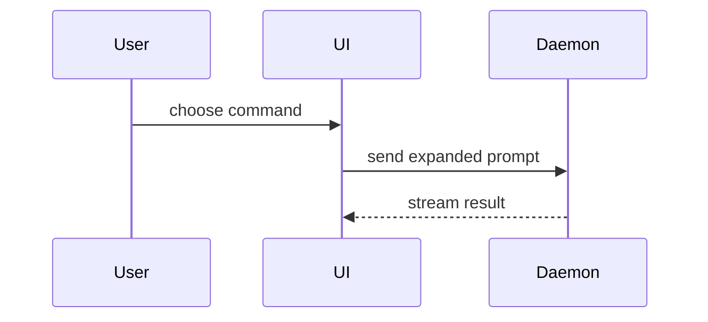

# TASK

Harden the work on branch `{{BRANCH}}` against `{{TARGET_BRANCH}}` and GitHub issue {{TASK_ID}}.

You are the strict second opinion (Cursor agent). Be pedantic. Prefer deleting and simplifying over adding.

# BOARD

Keep Status at **In Progress** while you work (set it if missing):

```bash
item=$(gh project item-add 3 --owner janmichek --url https://github.com/janmichek/design-bot/issues/{{TASK_ID}} --format json --jq .id)
gh project item-edit --project-id PVT_kwHOAOpt584BneoC --id "$item" \
  --field-id PVTSSF_lAHOAOpt584BneoCzhmDD0I --single-select-option-id 47fc9ee4
```

Do not move to Done or Ready 4 Review. Host opens a PR next and sets **Ready 4 Review**; after a human labels it `ready-for-agent`, the merger agent merges and marks Done.

# CONTEXT

## Issue (assignment)

!`gh issue view {{TASK_ID}} --json title,body,labels,comments --jq '{title,body,labels: [.labels[].name], comments: [.comments[]? | {author: .author.login, body}]}'`

## Branch diff

!`git diff {{TARGET_BRANCH}}...{{BRANCH}}`

## Commits on this branch

!`git log {{TARGET_BRANCH}}..{{BRANCH}} --oneline`
---
name: pr
description: "Use when writing a PR body."
metadata:
credits:
skill: show-me
author: Dex Horthy
organisation: Humanlayer
url: "https://github.com/humanlayer/skills/blob/main/plugins/show-me/skills/show-me/SKILL.md"
---

Use this template for writing the PR body:

```markdown
## Summary

<diagram, diff-sketch, or tree>

## Evidence

- **Before:** <screenshot/output/failing test run>
  **After:** <screenshot/output/passing test run>

## Merge Danger

**Door:** <one-way or two-way>

<optional: description>

**Blast Radius:** <one-word description>

<optional: potential ramifications of merge>
```

## Sections

Skip all preambles and keep prose brief. Use the user's domain language from `GLOSSARY.md`.

### Summary

Pick the smallest view that makes the key point clear.

- Show logic or an algorithm as pseudocode:

```text
on(save)
  if content is unchanged
    return cached result
  write new content
  return fresh result
```

- Show runtime control flow as a call tree:

```text
submitForm
  createSession
    persistPrompt
    launchAgent
  navigateToSession
```

- Show UI structure as a component tree, including state and module boundaries that matter:

```text
<SessionPage> (apps/example/src/routes/session.tsx)
  useSessionEvents()
  <SessionToolbar>
    <RunSkillButton> (packages/ui)
```

- Show file responsibility or a broad refactor as a shallow file tree:

```text
src/
├── commands/       # parses user actions
├── sessions/       # owns session state
└── transport/      # sends API requests
```

- Show component interaction, control flow, or data flow with Mermaid:



- Use `diff` when the point is what changes and the surrounding shape already exists. Match the diff shape to the topic.

For a component change:

```diff
 <SessionPage>
   useSessionEvents()
   <SessionToolbar>
+    <RunSkillButton />
   <SessionTimeline>
+    <SkillResultCard />
```

For a file-layout change:

```diff
 src/
 ├── commands/
+│   └── show-me.ts       # expands the slash command
 ├── sessions/
-└── transport.ts
+└── transport/
+    ├── client.ts
+    └── stream.ts
```

For a call-tree or call-stack change:

```diff
 submitForm
   createSession
     persistPrompt
+    expandSkillMention
     launchAgent
-  navigateToSession
+  navigateToSession
+    subscribeToEvents
```

For a state or control-flow change:

```diff
 on(save)
-  write content
+  if content is unchanged
+    return cached result
+  write new content
+  invalidate cache
```

- Show the whole block when most of it is new, when omitted context would hide ownership or order, or when the user needs a copyable target shape:

```ts
function expandSkill(command: string): string {
  const skillName = command.slice(1);
  return `use the ${skillName} skill`;
}
```

#### Guidance

Place each visual next to the short text it supports. Keep only the calls, files, props, states, and boundaries needed to answer the user's current question or the options to resolve the current discussion point.

You may use one of these, you may use several, it is unlikely you will use all of them. Use your judgement and don't overwhelm the user.

### Evidence

Concrete evidence that the change works. Show a before and after.

Screenshots are S-tier - when the environment is set up for it and the change is visual.

Execution-based evidence is A-tier. Test results, console output. Show the exact test that now fails and passes, using pseudocode.

### Merge Danger

Describe whether it's a one-way or two-way door. You can walk back through two-way doors, but not one-way doors. A PR that is cheap to roll back is lower risk. Changes that involve destructive actions or hard-to-reverse decisions are one-way doors.

The blast radius is the potential impact or scope of the changes introduced by this PR. Consider all possibilities. Examples are layout shift, breakages for consumers, mobile responsiveness, etc.


# LOOP (repeat until clean)

Run steps **Validate → Code review → Security** as a loop. After each full pass, if you changed code, commit and run the three steps again. Stop the loop only when a pass finds **no material findings** (no assignment gaps, no review/security fixes left worth a commit).

## 1. Validate against assignment

Check the branch against issue {{TASK_ID}} (and any linked parent/spec it names).

- Every requirement is met, or an explicit gap is left as a `gh` issue comment (do not close the issue).
- No scope creep that the issue did not ask for.
- Run `npm run check`. Fix failures before continuing.

## 2. Code review + desloppify

Call the Skill tool with `code-review`. Fixed point: `{{TARGET_BRANCH}}`. Spec source: issue {{TASK_ID}}. Standards: `.sandcastle/CODING_STANDARDS.md` plus in-repo standards the skill finds.

Then a second, stricter pass yourself (you are the second opinion):

- Over-engineered parts, unused abstractions, dead code, abandoned attempts, duplicate solutions or files → remove or collapse them.
- Prefer the smallest design that still passes Validate.
- Fix what you agree with; commit.

## 3. Security audit and fix

Audit the diff (and any new dependencies/touch points) for:

- Injection, command/path abuse, unsafe deserialization
- Secret leaks, logging of tokens/PII, credential handling
- AuthZ gaps, trust-boundary mistakes
- Unsafe casts / `any` that hide untrusted input

Fix real issues. Commit. Then return to Validate.

# AFTER THE LOOP IS CLEAN

## 4. Coverage

Improve tests for the feature this branch introduces or changes.

- Aim for **≥ 90%** line coverage on the touched feature modules (not necessarily the whole repo).
- Cover edge cases the assignment implies.
- Prefer: `npx vitest run --coverage` (install `@vitest/coverage-v8` only if missing and needed). Scope reports to the changed files/dirs when possible.
- Commit coverage improvements.

## 5. Demo artifact (only if a browser UI exists)

This repo is primarily a Telegram/CLI bot. **Skip** unless this branch adds or changes a real browser UI.

If it does: record high-res Playwright videos of happy paths / main flows (visible cursor), suitable for later PR attachment. Commit artifacts under a sensible path (e.g. `.scratch/` or `docs/demos/`) and note the paths in a `gh` issue comment.

## 6. UI/UX polish (only if a UI surface exists)

**Skip** unless this branch touches user-visible UI (web, rich Telegram layout, rendered visuals with CSS-like presentation).

If it does: mature polish only — subtle microinteractions, transitions, “more with less”. Prefer CSS (or equivalent easily removable presentation) over new JS machinery. Do not overdo it. Commit.

# RULES

- Stay on `{{BRANCH}}`. Never discard work (`reset --hard`, wiping the tree, unpopped stashes).
- Preserve behaviour unless Validate or Spec says it is wrong.
- Do not close the issue.
- When Validate + review + security are clean and coverage (and any applicable UI steps) are done, output <promise>COMPLETE</promise>.
